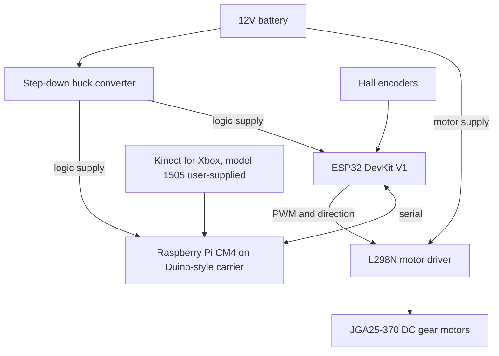

# amr-snall-robot

Small home AMR (autonomous mobile robot) hobby project. This repository is the initial scaffold: firmware that can be flashed to the ESP32, a ROS 2 package skeleton for the Raspberry Pi CM4, and places to put printed parts and wiring notes.

Electrical and mechanical numbers for this robot are unset until they are measured. The tables below name the parts and leave ratings blank on purpose.

## Overview

Low-level control runs on an ESP32 DevKit V1: L298N PWM and direction for a differential drive, quadrature counts from the motor hall encoders, and a small serial protocol. High-level compute is a Raspberry Pi Compute Module 4 on a Duino-style carrier, with ROS 2 as the intended software stack. Depth sensing is a Microsoft Kinect for Xbox. The model string supplied for this repo is `1505`; it has not been matched to a Kinect generation here.

The chassis and other mechanical parts are 3D printed. CAD and mesh files are not in the tree yet.

A static operator page, ROBZONE Mission Control 11.2, lives in `web/mission-control`.

## Repository layout

| Path | Contents |
| --- | --- |
| `firmware/esp32` | PlatformIO project for the ESP32 DevKit V1. |
| `ros2_ws/src/amr_base` | Placeholder ROS 2 package: base-driver bridge and Kinect bringup. |
| `hardware/3d-parts` | Future STL and STEP files. |
| `hardware/electronics` | Proposed pinout. |
| `web/mission-control` | ROBZONE Mission Control 11.2 dashboard (static HTML). |
| `docs` | Serial protocol and notes on the dashboard's HTTP calls. |

## Hardware

| Qty | Part | Role | Recorded here |
| --- | --- | --- | --- |
| — | 3D-printed chassis and parts | Mechanical structure | No files yet. See `hardware/3d-parts`. |
| 1 | ESP32 DevKit V1 | Motor PWM, encoder counts, serial link | WROOM-32 DevKit assumed for the pin map. |
| 1 | Raspberry Pi CM4 on a Duino-style carrier | High-level compute, intended ROS 2 host | RAM, storage, and carrier part number are unset. |
| 2 | JGA25-370 DC gear motor with hall encoder | Left and right differential drive | Rated voltage, gear ratio, and encoder counts are unset. This name covers more than one motor variant. |
| 1 | Microsoft Kinect for Xbox | Depth sensor | User-supplied model string: `1505`. |
| 1 | L298N motor driver | Dual H-bridge for the two motors | Module current rating and input thresholds are unset. |
| 1 | Step-down buck converter | Logic supply from the battery | Output voltage and current rating are unset. |
| 1 | 12 V battery | Main pack | Chemistry and capacity are unset. |

## Architecture

Motor current is drawn from the battery into the L298N motor supply. The buck feeds logic on the CM4 carrier and the ESP32. The ESP32-to-L298N link is PWM and direction, not motor current.



## Wiring notes

Confirm these on the bench. Details and the proposed GPIO map are in [hardware/electronics/pinout.md](hardware/electronics/pinout.md).

- Tie battery negative, buck ground, L298N ground, ESP32 ground, and CM4 ground together.
- Measure the buck output before it is connected to the CM4 carrier or the ESP32. The carrier's required input voltage is unset. An ESP32 DevKit V1 is powered from USB or from its 5V/VIN pin; the 3V3 pin is an output of the DevKit's regulator.
- Confirm the JGA25-370 nameplate voltage before the 12 V pack lands on the L298N motor supply. The motor family includes more than one rated voltage.
- Remove the L298N `ENA` and `ENB` jumpers when those pins are driven by ESP32 PWM.
- ESP32 GPIO high is 3.3 V. Confirm that level is a valid high for the L298N inputs on this module, or level-shift the six control lines.
- Confirm the hall-encoder high level before it touches a GPIO. GPIO 34, 35, 36, and 39 have no internal pull-ups. A 5 V encoder swing can damage the ESP32.
- Fuse the motor supply. Stall current of these motors, and the continuous rating of this L298N module, are unset.
- Cross ESP32 UART2 TX/RX to the CM4 UART, and share ground. The carrier header and the Linux device node are unset. Both ends are expected to be 3.3 V logic; confirm the header.
- Leave ESP32 strapping pins (GPIO 0, 2, 12, 15), the USB console (GPIO 1 and 3), and the flash pins (GPIO 6–11) out of the harness.
- Kinect data is USB into the CM4. Power for the user-supplied model `1505` is unset, so the sensor is not assumed to run from the CM4 USB port alone.
- Many L298N boards can put an onboard regulator onto a `+5V` pin via a jumper. Confirm that jumper on the silkscreen before using the pin to power anything.

## Serial link

USB serial and UART2 both speak the line protocol in [docs/serial-protocol.md](docs/serial-protocol.md) at 115200 8N1. The CM4 is expected to send per-wheel `DRIVE` commands. Mixing `cmd_vel` into wheel speeds waits on a measured wheel radius and track width. If the ESP32 is commanding motion and no valid command arrives for 500 ms, it coasts the motors.

## Firmware

PlatformIO project: `firmware/esp32`, environment `esp32dev`.

```bash
pio run -d firmware/esp32
```

The `espressif32` platform pinned in `platformio.ini` packages Arduino-ESP32 2.0.17, so PWM uses `ledcSetup` / `ledcAttachPin`. Upload (`pio run -t upload`) needs the DevKit on USB.

## ROS 2 workspace

`ros2_ws/src/amr_base` is a placeholder package with two nodes:

- `base_driver_node` subscribes to `cmd_vel` and advertises `odom`. It does not open a serial port and does not publish odometry.
- `kinect_freenect_node` advertises image topics. libfreenect is not linked, and no frames are published. Whether model `1505` is a libfreenect (Kinect v1-class) device or needs libfreenect2 is unset.

The ROS 2 distribution on the CM4 is not chosen. When one is installed:

```bash
cd ros2_ws
source /opt/ros/<distro>/setup.bash
colcon build --packages-select amr_base
```

## Roadmap

1. Bench-check grounds, the buck voltage, and the proposed pin map with the motors unplugged.
2. Flash the ESP32 scaffold. With the wheels off the ground, exercise `DRIVE`, `STOP`, the command timeout, and `ENC`.
3. Choose a ROS 2 distribution on the CM4 and implement the serial bridge: `cmd_vel` in, `DRIVE` out, encoder ticks in. Publish `odom` after wheel radius and track width are measured.
4. Identify the Kinect behind the user-supplied model string `1505`, including how it is powered. Link libfreenect for a supported Kinect v1-class device, or a Kinect v2 stack if that is what the sensor is.
5. Add STL and STEP files under `hardware/3d-parts`, and record dimensions from those files or from the printed parts.
6. Teleoperate the base, then try autonomous navigation once odometry and depth are real.

## Mission control

`web/mission-control/index.html` is the ROBZONE Mission Control 11.2 page, checked in as supplied. It draws a map, keeps a station list, and requests telemetry, a camera image, tilt, map save/load, emergency stop, and Pi shutdown from whatever host serves the file.

Serve that directory and open the page in a browser:

```bash
python3 -m http.server 8080 --directory web/mission-control
```

Then open `http://127.0.0.1:8080/`.

This static server only delivers the HTML. The page's `/api/...`, `/tilt/...`, and `/video_feed` routes are not implemented in this repository. Those calls, and the fact that they are separate from the ESP32 serial protocol, are listed in [docs/mission-control.md](docs/mission-control.md).

## License

[MIT](LICENSE). Copyright (c) 2026 Vlatko Macak.
