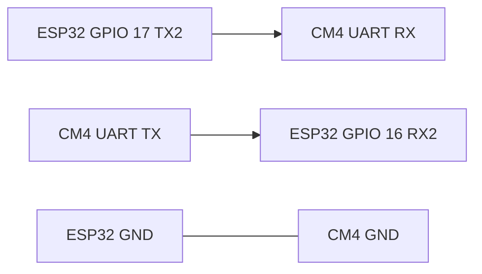

# Electronics pinout

Proposed wiring for the ESP32 DevKit V4. The 30-pin V4 uses the same GPIO map as the DevKit V1. These GPIO numbers match `firmware/esp32/include/pins.h`. They are a starting assignment, not a record of a built harness. Confirm every net on the bench before a motor or encoder is connected.

The DevKit in this scaffold is the common ESP32-WROOM-32 module (no PSRAM). GPIO 16 is a PSRAM pin on WROVER modules; check the module before using this UART map on a different board.

The motors are JGA25-371, 12 V, 1000 RPM output, with Hall encoders. The gear ratio has not been counted. The placeholder is 9.6 motor-shaft turns per wheel turn.

## Power

| From | To | Check before connecting |
| --- | --- | --- |
| 12 V battery positive | Buck input, and L298N motor supply | The JGA25-371 nameplate is 12 V. Stall current is still unset. |
| 12 V battery negative | Buck ground, L298N ground, ESP32 ground, CM4 ground | One common ground. |
| Buck output | CM4 carrier logic input | Carrier input voltage and the buck setpoint are unset. Measure the buck before it touches the carrier. |
| Buck output, or the DevKit USB port during firmware work | ESP32 5V / VIN pin | DevKit V4 boards are powered from 5 V on that pin or from USB. Keep the buck off that pin until its output has been measured. The 3V3 pin is a regulated output of the DevKit, not a power input. |
| ESP32 3V3 pin | Hall-encoder VCC (blue) | The encoder accepts 3.3–5 V. Use 3.3 V from the DevKit so the Hall high stays inside GPIO limits. Do not feed 5 V into A or B. |

Motor current is intended to flow from the battery into the L298N motor supply and out to the motors. It is not intended to flow through the buck or through the ESP32.

Many L298N modules have a jumper that enables an onboard regulator onto the logic `+5V` pin. Confirm that jumper against the silkscreen of the module in hand. The logic source in this scaffold is the buck, once its voltage is known.

## ESP32 to L298N

Remove the `ENA` and `ENB` jumpers so those pins take PWM from the ESP32.

| ESP32 GPIO | L298N pin | Function |
| --- | --- | --- |
| 25 | ENA | Left motor PWM, LEDC channel 0, 1 kHz, 8-bit |
| 26 | IN1 | Left direction |
| 27 | IN2 | Left direction |
| 14 | ENB | Right motor PWM, LEDC channel 1, 1 kHz, 8-bit |
| 32 | IN3 | Right direction |
| 33 | IN4 | Right direction |
| GND | GND | Common ground |

`DRIVE` positive drives `IN1`/`IN3` high and `IN2`/`IN4` low. `STOP`, a zero command, and a command timeout drive both inputs low and the PWM to 0 (coast, not brake). Swap a motor's output pair if that wheel's mechanical forward does not match the firmware sign.

ESP32 GPIO high is 3.3 V. Confirm the L298N input thresholds on the module in hand, and level-shift the six control lines if 3.3 V is not a valid high.

`OUT1`/`OUT2` are the left motor and `OUT3`/`OUT4` are the right motor in this map. Which side of the chassis is left is defined when the chassis exists. Red is motor positive and white is motor negative on the JGA25-371 lead.

## JGA25-371 wire colors

Same colors on both motors. Encoder A and B land on different GPIOs.

| Color | Wire | Left motor | Right motor |
| --- | --- | --- | --- |
| Red | Motor + | L298N OUT1 | L298N OUT3 |
| White | Motor − | L298N OUT2 | L298N OUT4 |
| Black | Encoder GND | ESP32 GND | ESP32 GND |
| Blue | Encoder VCC, 3.3–5 V | ESP32 3V3 | ESP32 3V3 |
| Yellow | Encoder A | GPIO 18 | GPIO 21 |
| Green | Encoder B | GPIO 19 | GPIO 22 |

GPIO 18, 19, 21, and 22 are interrupt-capable and have internal pull-ups. The firmware enables `INPUT_PULLUP`. GPIO 34, 35, 36, and 39 are input-only and have no internal pull-up, so they are not used for these Hall lines. The Hall outputs are open-collector. If ticks skip, add an external pull-up from yellow and from green to the same 3.3 V rail as the blue wire. Do not pull them up to 5 V.

A positive `DRIVE` command drives OUT1 and OUT3 high relative to OUT2 and OUT4. If a wheel then turns backward, swap that motor's red and white at the L298N. Swapping yellow and green flips the tick sign.

## ESP32 to CM4

UART2, 115200 8N1, the same protocol as USB serial. See [docs/serial-protocol.md](../../docs/serial-protocol.md).

| ESP32 GPIO | CM4 carrier UART | Notes |
| --- | --- | --- |
| 17 (TX2) | RX | Crossed |
| 16 (RX2) | TX | Crossed |
| GND | GND | Required |

These are the Arduino core defaults for `Serial2` on this DevKit. The carrier's UART header and the CM4 device node (`/dev/ttyAMA0`, `/dev/ttyS0`, `/dev/serial0`, or something else) depend on the carrier and the device tree. Both are unset here. ESP32 and CM4 UARTs on these modules are 3.3 V logic; confirm the carrier header before connecting it.

## Kinect

Data path is USB from the Kinect to the CM4. The sensor is model `1414`, the original Xbox 360 Kinect. Power it from its own 12 V adapter. Do not run it from the CM4 USB port alone.

## GPIOs left unused

## Battery sense

| ESP32 GPIO | Function | Notes |
| --- | --- | --- |
| 4 | ADC for a pack divider | Proposed. ADC2 channel. WiFi is unused in this firmware. Do not connect the pack to this pin. Meter the divider output first. `kBatteryDividerRatio` is `1.0` until you enter `(R_top + R_bottom) / R_bottom`. |

Left free on purpose: GPIO 5, 13, 23. GPIO 4 is reserved above for the divider. GPIO 34, 35, 36, and 39 are free only as bare inputs; they have no internal pull-up, so they are a poor match for the Hall leads.

Left unused because they are poor harness pins on a DevKit V4 (same limits as V1):

| GPIO | Reason |
| --- | --- |
| 0, 2, 12, 15 | Strapping pins. Level at reset changes boot behaviour. GPIO 2 is also the LED on many DevKit boards. |
| 1, 3 | UART0 TX/RX to the USB serial bridge. |
| 6–11 | Connected to the module's SPI flash. |
| 34, 35, 36, 39 | Input only. No internal pull-up. |
