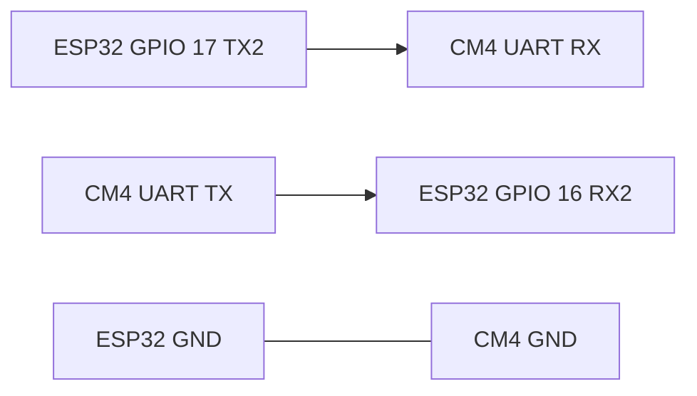

# Electronics pinout

Proposed wiring for the ESP32 DevKit V1. These GPIO numbers match `firmware/esp32/include/pins.h`. They are a starting assignment, not a record of a built harness. Confirm every net on the bench before a motor or encoder is connected.

The DevKit in this scaffold is the common ESP32-WROOM-32 module (no PSRAM). GPIO 16 is a PSRAM pin on WROVER modules; check the module before using this UART map on a different board.

## Power

| From | To | Check before connecting |
| --- | --- | --- |
| 12 V battery positive | Buck input, and L298N motor supply | Motor rated voltage is unset. JGA25-370 is sold as more than one voltage. |
| 12 V battery negative | Buck ground, L298N ground, ESP32 ground, CM4 ground | One common ground. |
| Buck output | CM4 carrier logic input | Carrier input voltage and the buck setpoint are unset. Measure the buck before it touches the carrier. |
| Buck output, or the DevKit USB port during firmware work | ESP32 5V / VIN pin | DevKit V1 boards are powered from 5 V on that pin or from USB. Keep the buck off that pin until its output has been measured. The 3V3 pin is a regulated output of the DevKit, not a power input. |
| Encoder supply | Hall-encoder VCC | Encoder supply voltage and logic swing are unset. |

Motor current is intended to flow from the battery into the L298N motor supply and out to the motors. It is not intended to flow through the buck or through the ESP32.

Many L298N modules have a jumper that enables an onboard regulator onto the logic `+5V` pin. Confirm that jumper against the silkscreen of the module in hand. The logic source in this scaffold is the buck, once its voltage is known.

## ESP32 to L298N

Remove the `ENA` and `ENB` jumpers so those pins take PWM from the ESP32.

| ESP32 GPIO | L298N pin | Function |
| --- | --- | --- |
| 25 | ENA | Left motor PWM, LEDC channel 0, 1 kHz, 8-bit |
| 26 | IN1 | Left direction |
| 27 | IN2 | Left direction |
| 14 | ENB | Right motor PWM, LEDC channel 1, 1 kHz, 8-bit |
| 32 | IN3 | Right direction |
| 33 | IN4 | Right direction |
| GND | GND | Common ground |

`DRIVE` positive drives `IN1`/`IN3` high and `IN2`/`IN4` low. `STOP`, a zero command, and a command timeout drive both inputs low and the PWM to 0 (coast, not brake). Swap a motor's output pair if that wheel's mechanical forward does not match the firmware sign.

ESP32 GPIO high is 3.3 V. Confirm the L298N input thresholds on the module in hand, and level-shift the six control lines if 3.3 V is not a valid high.

`OUT1`/`OUT2` are the left motor and `OUT3`/`OUT4` are the right motor in this map. Which side of the chassis is left is defined when the chassis exists.

## Encoders to ESP32

Quadrature A/B on each motor. Confirm the motors actually bring out two channels; a single pulse wire needs a firmware change.

| ESP32 GPIO | Signal | Notes |
| --- | --- | --- |
| 34 | Left A | Input only. No internal pull-up. |
| 35 | Left B | Input only. No internal pull-up. |
| 36 (VP) | Right A | Input only. No internal pull-up. |
| 39 (VN) | Right B | Input only. No internal pull-up. |

Add external pull-ups if the encoder outputs are open-drain. Confirm the high level is within ESP32 GPIO limits before the wires land. A 5 V swing on these pins can damage the MCU.

## ESP32 to CM4

UART2, 115200 8N1, the same protocol as USB serial. See [docs/serial-protocol.md](../../docs/serial-protocol.md).

| ESP32 GPIO | CM4 carrier UART | Notes |
| --- | --- | --- |
| 17 (TX2) | RX | Crossed |
| 16 (RX2) | TX | Crossed |
| GND | GND | Required |

These are the Arduino core defaults for `Serial2` on this DevKit. The carrier's UART header and the CM4 device node (`/dev/ttyAMA0`, `/dev/ttyS0`, `/dev/serial0`, or something else) depend on the carrier and the device tree. Both are unset here. ESP32 and CM4 UARTs on these modules are 3.3 V logic; confirm the carrier header before connecting it.

## Kinect

Data path is USB from the Kinect to the CM4. The user-supplied model string is `1505`. Power requirements for that model are unset, so the Kinect is not assumed to run from the CM4 USB port alone.

## GPIOs left unused

Left free on purpose: GPIO 4, 5, 13, 18, 19, 21, 22, 23.

Left unused because they are poor harness pins on a DevKit V1:

| GPIO | Reason |
| --- | --- |
| 0, 2, 12, 15 | Strapping pins. Level at reset changes boot behaviour. GPIO 2 is also the LED on many DevKit V1 boards. |
| 1, 3 | UART0 TX/RX to the USB serial bridge. |
| 6–11 | Connected to the module's SPI flash. |
